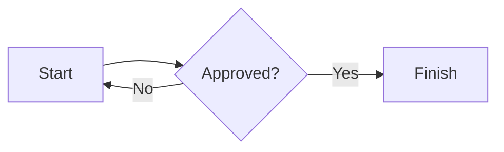

# FoliMarkdown

**[Open the live demo →](https://winai543.github.io/FoliMarkdown/)**

A Markdown document editor with paginated previews, document storage, and exports. Open `index.html` in a browser; no build step or server is required. All local CSS and JavaScript files must remain alongside `index.html` in their folders.


The demo runs directly in your browser. Documents and images stay in your browser storage; use Markdown export/import to move them between the demo, local files, and the desktop app. GitHub Pages deploys the static editor automatically when its source files change on `main`.

## Desktop app (Tauri 2)

FoliMarkdown also includes a native desktop wrapper for **macOS, Linux, and Windows**. It uses the same editor, with system save dialogs for Markdown, HTML, DOCX, and PDF, external links opened in your default browser, and document saving before the window closes. Documents are stored in the desktop app's WebView profile, separately from documents in your browser; use Markdown export/import to transfer them.

Install Node.js 22.12+ and Rust 1.91+ (current stable recommended), plus the [Tauri platform prerequisites](https://v2.tauri.app/start/prerequisites/):

- **macOS:** Xcode Command Line Tools. Local builds use your Mac's architecture. For a universal Apple Silicon/Intel build, install both Rust targets: `rustup target add aarch64-apple-darwin x86_64-apple-darwin`.
- **Windows:** Visual Studio Build Tools with **Desktop development with C++**, the Windows SDK, and Microsoft Edge WebView2.
- **Linux (Ubuntu/Debian):** install the WebKitGTK and build dependencies below. Build installers on the platform they target.

```sh
sudo apt-get update
sudo apt-get install -y libwebkit2gtk-4.1-dev build-essential libxdo-dev libssl-dev libayatana-appindicator3-dev librsvg2-dev patchelf xdg-utils libfuse2
```

```sh
npm ci
npm run desktop:dev
```

To make installers:

```sh
npm run desktop:build
# Universal macOS build (after adding both Rust targets):
npm run desktop:build -- --target universal-apple-darwin --bundles app,dmg
```

The desktop build copies `index.html`, `src/`, `styles/`, `vendor/`, and the public `docs/images/` screenshots to `dist/`. It does not change the browser version: you can still open the root `index.html` without installing dependencies. In development, edit the root source files and restart `npm run desktop:dev` to refresh the copied assets. Build output is under `src-tauri/target/release/bundle/` (or `src-tauri/target/universal-apple-darwin/release/bundle/` for universal macOS).

The **Desktop builds** GitHub Actions workflow runs frontend tests, then builds a universal macOS `.dmg`, Linux x64 `.deb`/`.AppImage`, and Windows x64 `.exe`/`.msi`. Download these from each successful workflow run's **Artifacts** section. The workflow also runs manually through **Actions → Desktop builds → Run workflow**. Builds are unsigned; public signed/notarized distribution requires your platform signing credentials. The workflow builds installers and does not publish a release automatically.

In the desktop app, **Print / PDF** and `Ctrl/⌘ + P` save a PDF through the system save dialog; open that PDF in your system viewer to print it. This uses the same rasterized export as **Export PDF**. Browser Print / PDF still uses the browser's print dialog. Mermaid and optional Google Fonts still need an internet connection.

Desktop checks:

```sh
npm test
npm run build:web
cargo test --locked --manifest-path src-tauri/Cargo.toml
```

## Features

- Live GitHub Flavored Markdown preview: nested lists, tables, task lists, code, links, and images.
- A4/Letter paper, portrait/landscape, margins, headers, footers, page numbers, page breaks, and document fonts.
- Form-based settings for bar, line, pie charts, and timelines: edit titles, axis labels/limits, and data rows with a live preview. Click **Edit chart** on a preview, or place the cursor inside its Markdown block and choose **Chart → Edit chart**. Advanced Mermaid syntax remains editable in the source.
- Mermaid charts and diagrams from fenced `mermaid`, `chart`, or `diagram` blocks. Mermaid is loaded on demand from a CDN and needs an internet connection; the rest of the editor works offline.
- Find and replace (one or all), result highlighting, outline navigation, undo/redo, and keyboard shortcuts.
- Multiple documents in IndexedDB: create, rename, duplicate, move to Trash, restore, or permanently delete. Autosave and draft recovery are enabled. If IndexedDB is unavailable, the app falls back to `localStorage` with limited capacity.
- Insert PNG, JPEG, GIF, WebP, and AVIF images by selecting a file, pasting, or dragging and dropping (up to 8 MB each, 16 MB per batch). The editor uses short `asset:` references and stores image data separately in the browser. SVG uploads are not supported.
- Export Markdown (`.md`), standalone HTML, editable DOCX, and PDF; or use the browser's Print / Save as PDF dialog.

## Chart and timeline settings

Create a chart with the settings dialog—no Mermaid syntax is required. Try it in the **[live demo](https://winai543.github.io/FoliMarkdown/)**.

1. Place the cursor where you want the chart in your document.
2. Open **Chart** and choose **Bar chart**, **Line chart**, or **Pie chart**. For a timeline, choose **Diagram → Timeline**.
3. Enter a **Title**, then fill in the **Data** rows. Use **＋ Add row** to add an item or **×** beside a row to remove it.
4. For bar and line charts, set optional horizontal/vertical axis labels. Leave **Minimum** and **Maximum** blank for automatic scaling, or enter both limits. The minimum must be lower than the maximum, and the range must include all values.
5. Check the live **Preview**, then click **Insert into document**. The app inserts a standard Mermaid block and updates the paginated preview.

For example, to compare monthly sales, choose **Bar chart**, set the title to **Monthly sales**, and enter **Jan: 18**, **Feb: 27**, **Mar: 34**, and **Apr: 42** as label/value rows. Set the vertical label to **Sales** and the range to **0–50** to keep a zero baseline.


Choose a chart type to suit your data:

- **Bar chart:** compare categories, such as sales by month or expenses by department. Each row contains a label and a numeric value.
- **Line chart:** show a trend across ordered labels, such as Jan through Apr. Rows appear in the order you enter them.
- **Pie chart:** show parts of a whole, such as **Product A: 45**, **Product B: 30**, and **Product C: 25**. Values must be non-negative, and at least one must be greater than zero.
- **Timeline:** describe milestones with **Period** and **Event** fields, such as **2026: Plan** and **2027: Launch**. These fields accept text rather than numeric values.

<details>
<summary>View line chart, pie chart, and timeline dialogs</summary>

**Line chart**


**Pie chart**


**Timeline**


</details>

To update an existing chart, click **Edit chart** below its preview, or place the cursor in its fenced block and choose **Chart → Edit chart**. Adjust the fields and click **Save changes**. Saving updates that block and supports Undo/Redo; **Cancel**, **×**, or **Escape** closes the dialog without changing the document. The **Type** selector also lets you switch chart types before saving.

Expand **Mermaid source** in the dialog to inspect the generated syntax. The chart stays in your Markdown, so it remains portable through Markdown export/import. The preview needs an internet connection to load Mermaid; the form can still save settings when the preview is unavailable. Existing built-in chart examples can be edited with the form, while diagrams with additional Mermaid commands remain editable in the source editor.

## Images referenced by path

Relative image links such as ``, ``, and `` now render in the preview. Images served alongside the editor resolve relative to its URL; the bundled demo screenshots are available on GitHub Pages and in the desktop app.

For Markdown and images on your computer:

1. Choose **File → Open folder** and select the project folder containing the Markdown file and its images.
2. If the folder contains several Markdown files, choose the document to open. Image paths resolve from that document's directory, including `../` paths within the selected folder.
3. For a document already open through **Open file**, choose **File → Link image folder** and select the folder that its image paths start from. For `docs/images/photo.png`, select the folder containing `docs/`.

The editor keeps the original paths in your Markdown and stores the matched images in its document library, so they survive reloads and document duplication. Markdown export embeds linked images as data URLs; HTML, DOCX, and PDF use those stored images too. Local paths with spaces or percent-encoded spaces and reference-style Markdown images are supported. Folder linking supports PNG, JPEG, GIF, WebP, and AVIF, with the same 8 MB per image and 16 MB total limit as image insertion. Unmatched or unsupported paths are reported after import/linking.

Opening a Markdown file alone does not grant a browser access to neighboring files. Use **Open folder** or **Link image folder** when those local images are missing. Unlinked relative images can still render when they exist beside the editor, but HTML export keeps their absolute URL and they still depend on the original files or server. Link the image folder to embed them for a portable export.

## Export details

- **Markdown:** exported `.md` files include page layout metadata in an HTML comment and embed locally stored images as data URLs. Older `mdword:layout` comments remain importable. Copying the editor's raw `asset:` references alone does *not* include images; use Download Markdown to move a document elsewhere.
- **HTML:** includes the application CSS and rendered pages. Google Fonts still require internet access when opened; rendered Mermaid SVGs are embedded.
- **DOCX:** headings, lists, tables, links, most inline formatting, headers/footers, and images remain editable or embedded. GIF/WebP/AVIF images and Mermaid visuals are converted to PNG. External images require successful CORS access. Pagination may differ from the browser preview, and a selected Google Font may need to be installed on the receiving computer.
- **PDF:** Export PDF downloads a rasterized PDF of the preview, preserving page appearance, images, and headers/footers. The text is *not* selectable or searchable. For a PDF with selectable text, use Print / PDF and choose Save as PDF instead. Large documents may take longer. External images must allow CORS to appear in the direct export.

Insert a manual page break on its own line with `<!-- pagebreak -->`.

Example diagram:

````markdown

````

## Keyboard shortcuts

| Shortcut | Action |
| --- | --- |
| `Ctrl/⌘ + B` / `Ctrl/⌘ + I` | Bold / italic in the editor |
| `Ctrl/⌘ + K` | Insert link |
| `Ctrl/⌘ + Enter` | Insert page break |
| `Ctrl/⌘ + Z` / `Ctrl/⌘ + Shift + Z` | Undo / redo |
| `Ctrl/⌘ + S` | Download Markdown |
| `Ctrl/⌘ + O` | Open a Markdown file |
| `Ctrl/⌘ + F` | Find in document |
| `Ctrl/⌘ + P` | Print / Save as PDF |

## Project structure

```text
index.html                 HTML layout and script loading order
styles/app.css             Application and print styles
src/state.js               Shared configuration and application state
src/markdown.js            Markdown parser configuration and preview rendering
src/diagrams.js            Mermaid loading, rendering, and retries
src/chart-model.js         Chart/timeline validation and Mermaid round trips
src/chart-editor.js        Form-based chart settings and live preview
src/layout.js              Paper settings, pagination, and visual readiness
src/search.js              Search, highlights, outline, and replace
src/storage.js             IndexedDB, records, autosave, and draft handling
src/assets.js              Image storage, insertion, and portable Markdown conversion
src/image-paths.js         Relative image resolution and linked folder imports
src/editor.js              Editing commands, selection, and undo history
src/view.js                View switching, navigation, and notifications
src/export-styles.js       Generated CSS fallback for standalone file:// exports
src/desktop.js             Native save, confirmation, rename, links, and save-on-close
src/files.js               Markdown import/export and standalone HTML export
src/library.js             Document library, Trash, and startup recovery
src/pdf.js                 Direct PDF export
src/docx.js                DOCX generation and ZIP packaging
src/actions.js             Toolbar action dispatch
src/events.js              DOM, keyboard, paste, and drag/drop listeners
src/boot.js                Starts the library after all feature scripts load
vendor/                    Third-party libraries, bundled for offline use
src-tauri/                 Rust desktop wrapper, capabilities, config, and app icons
scripts/build-web.cjs      Copies public assets into dist/ for Tauri
.github/workflows/desktop.yml  macOS, Linux, and Windows build jobs
```

The app deliberately uses **ordered classic scripts**, not ES modules: browsers may block module imports from `file://`. Each `src/` file uses the same global lexical scope and depends on the preceding scripts. Add new files before `src/events.js` and `src/boot.js` in `index.html` as appropriate; avoid redeclaring top-level `const` or `let` names. Keep third-party code in `vendor/` and do not edit it for app features. No package install, network access, or build tool is needed to run the application.

After editing `styles/app.css`, run `node scripts/sync-export-css.cjs` and commit the generated `src/export-styles.js`. This fallback embeds the same CSS in downloaded HTML when browsers block stylesheet access on `file://`. Check that it is current with `node scripts/sync-export-css.cjs --check`.

For browser smoke tests, run `npm ci` and `npm test` (or `node tests/smoke.cjs` for the browser suite alone). The tests use a temporary browser profile and local HTTP server, exercise both `file://` and HTTP, and check editing, persistence, portable images, standalone HTML screen/print styles, Markdown import, all four download formats, library operations, and mobile preview. Test documents and downloads are removed afterward.

## Storage and privacy

Documents and image assets stay in the current browser profile for this page's origin. They are not synchronized between devices; clearing site storage or using private browsing can erase them. Download `.md` backups regularly. If storage is full, older inline Base64 images are kept rather than discarded, and the app prompts you to back up your work.

## Third-party notices

`vendor/marked.min.js` uses **Marked 17 (MIT)**, `vendor/html2canvas.min.js` uses **html2canvas 1.4.1 (MIT)**, and `vendor/jspdf.umd.min.js` uses **jsPDF 3.0.3 (MIT)**. Copyright and license notices are retained in the distributed files. Mermaid is loaded from a CDN when needed, and Google Fonts are requested when selected. Keep the license notices when redistributing the app; the project is not affiliated with any other office software.
