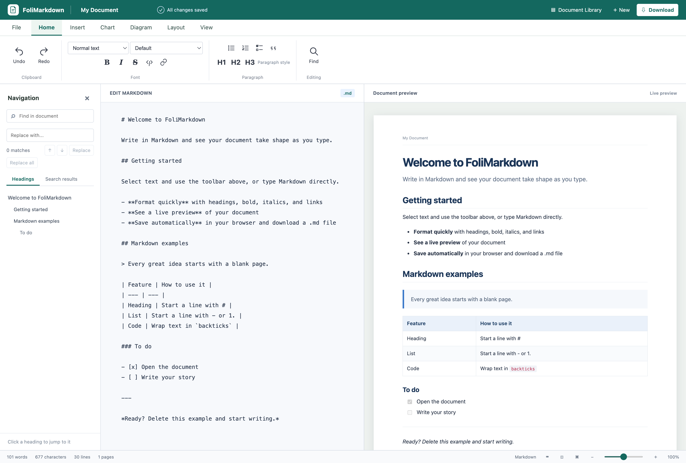
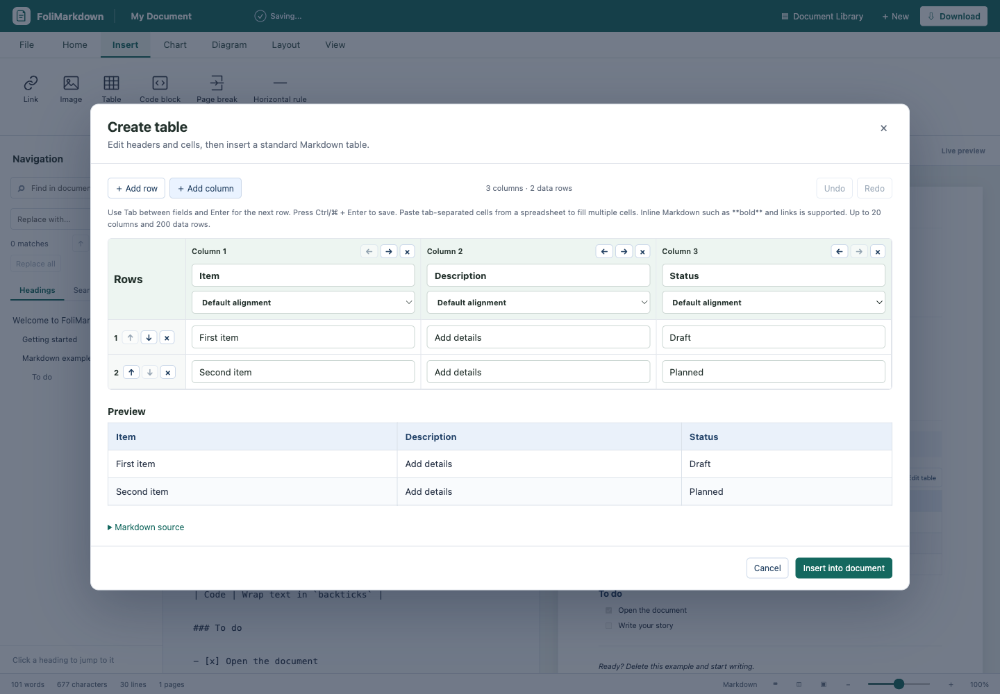
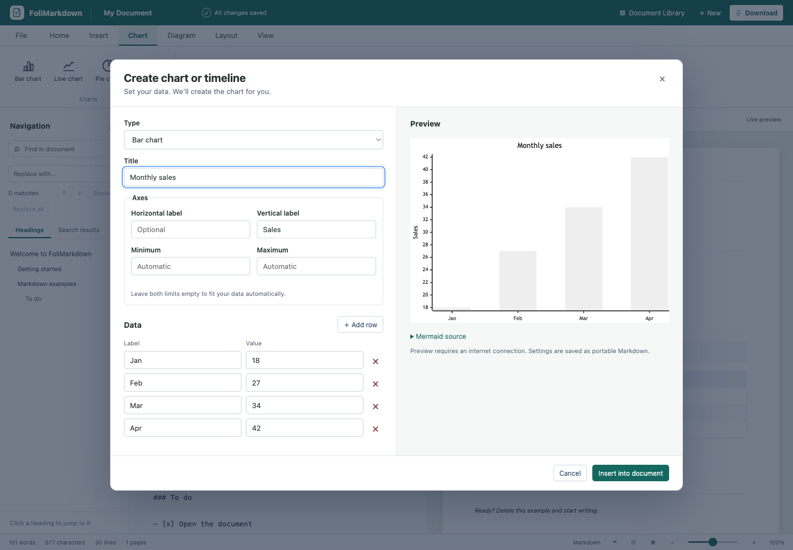
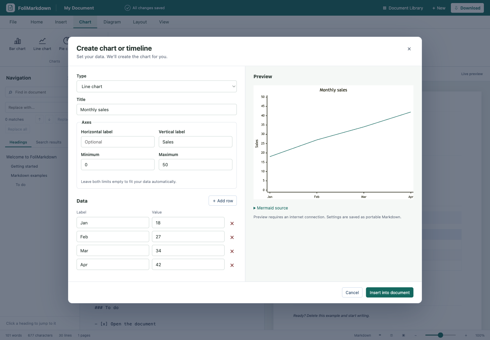
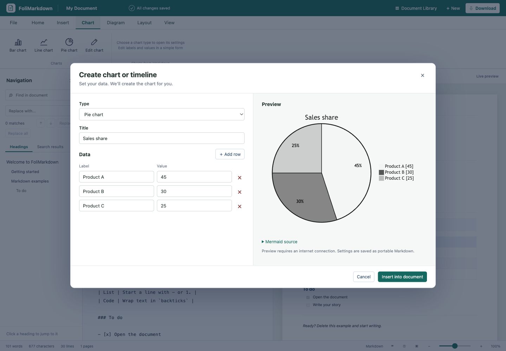
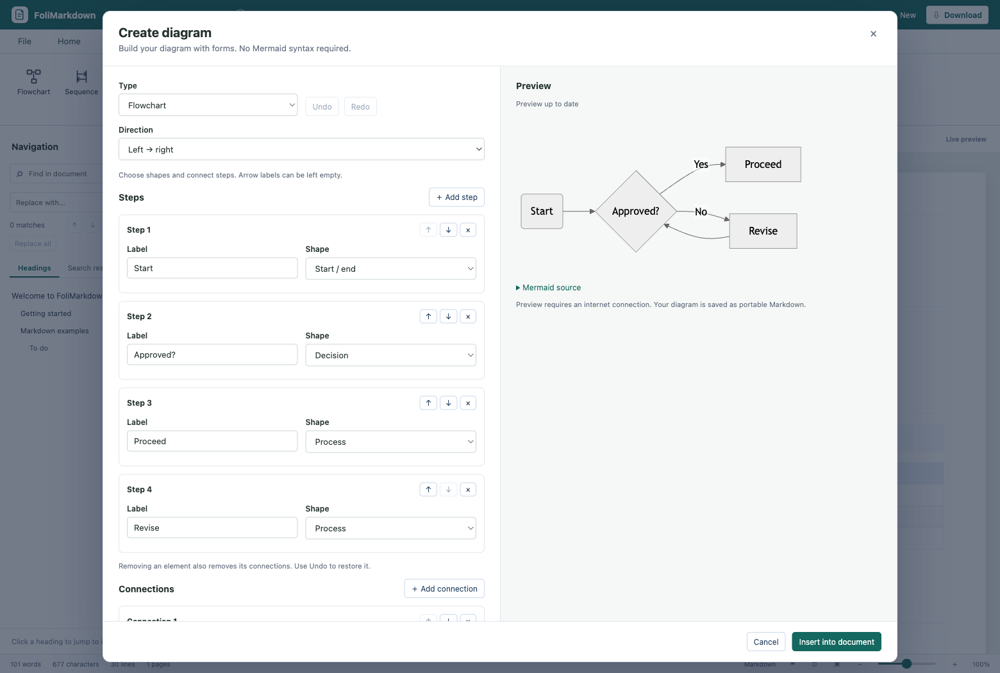
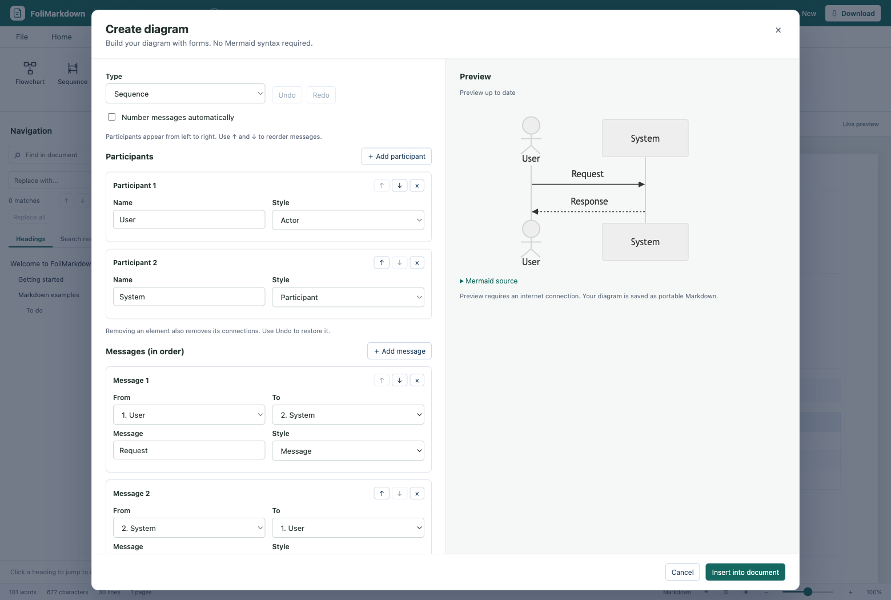
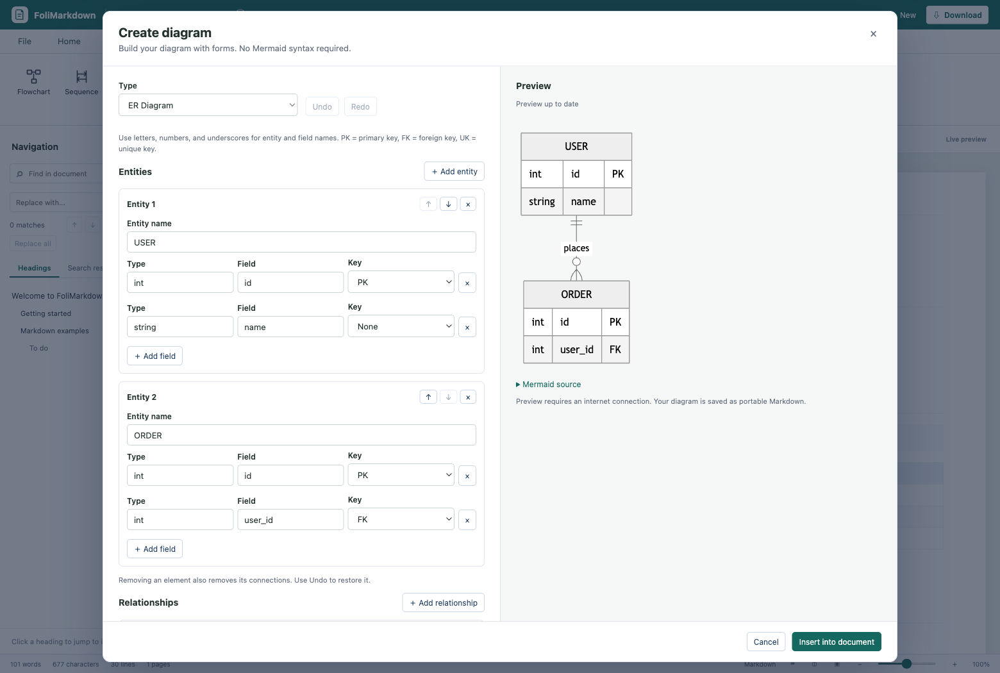
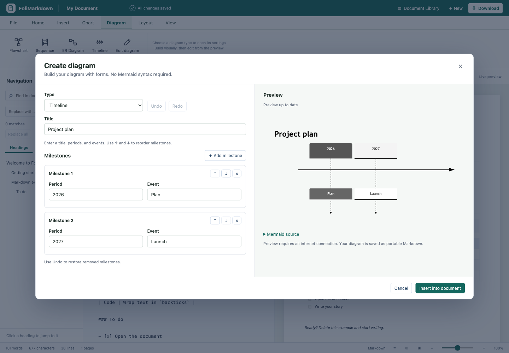
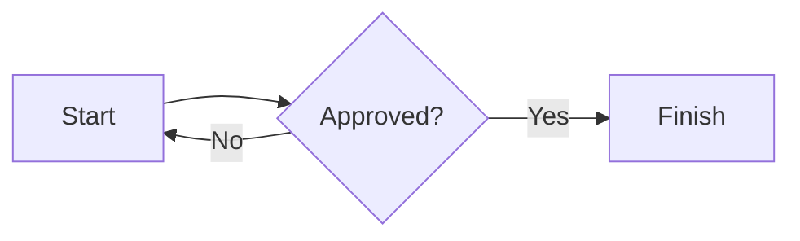

# FoliMarkdown

**[Open the live demo →](https://winai543.github.io/FoliMarkdown/)**

A Markdown document editor with paginated previews, document storage, and exports. Open `index.html` in a browser; no build step or server is required. All local CSS and JavaScript files must remain alongside `index.html` in their folders.



The demo runs directly in your browser. Documents and images stay in your browser storage; use Markdown export/import to move them between the demo, local files, and the desktop app. GitHub Pages deploys the static editor automatically when its source files change on `main`.

## Desktop app (Tauri 2)

FoliMarkdown also includes a native desktop wrapper for **macOS, Linux, and Windows**. It uses the same editor, with system save dialogs for Markdown, HTML, DOCX, and PDF, external links opened in your default browser, and document saving before the window closes. Documents are stored in the desktop app's WebView profile, separately from documents in your browser; use Markdown export/import to transfer them.

Install Node.js 22.12+ and Rust 1.91+ (current stable recommended), plus the [Tauri platform prerequisites](https://v2.tauri.app/start/prerequisites/):

- **macOS:** Xcode Command Line Tools. Local builds use your Mac's architecture. For a universal Apple Silicon/Intel build, install both Rust targets: `rustup target add aarch64-apple-darwin x86_64-apple-darwin`.
- **Windows:** Visual Studio Build Tools with **Desktop development with C++**, the Windows SDK, and Microsoft Edge WebView2.
- **Linux (Ubuntu/Debian):** install the WebKitGTK and build dependencies below. Build installers on the platform they target.

```sh
sudo apt-get update
sudo apt-get install -y libwebkit2gtk-4.1-dev build-essential libxdo-dev libssl-dev libayatana-appindicator3-dev librsvg2-dev patchelf xdg-utils libfuse2
```

```sh
npm ci
npm run desktop:dev
```

To make installers:

```sh
npm run desktop:build
# Universal macOS build (after adding both Rust targets):
npm run desktop:build -- --target universal-apple-darwin --bundles app,dmg
```

The desktop build copies `index.html`, `src/`, `styles/`, `vendor/`, and the public `docs/images/` screenshots to `dist/`. It does not change the browser version: you can still open the root `index.html` without installing dependencies. In development, edit the root source files and restart `npm run desktop:dev` to refresh the copied assets. Build output is under `src-tauri/target/release/bundle/` (or `src-tauri/target/universal-apple-darwin/release/bundle/` for universal macOS).

The **Desktop builds** GitHub Actions workflow runs frontend tests, then builds a universal macOS `.dmg`, Linux x64 `.deb`/`.AppImage`, and Windows x64 `.exe`/`.msi`. Download these from each successful workflow run's **Artifacts** section. The workflow also runs manually through **Actions → Desktop builds → Run workflow**. Builds are unsigned; public signed/notarized distribution requires your platform signing credentials. The workflow builds installers and does not publish a release automatically.

In the desktop app, **Print / PDF** and `Ctrl/⌘ + P` save a PDF through the system save dialog; open that PDF in your system viewer to print it. This uses the same rasterized export as **Export PDF**. Browser Print / PDF still uses the browser's print dialog. Mermaid and optional Google Fonts still need an internet connection.

Desktop checks:

```sh
npm test
npm run build:web
cargo test --locked --manifest-path src-tauri/Cargo.toml
```

## Command-line conversion

For complete usage, options, and API examples in Thai, see the [CLI guide](docs/cli.md).

The CLI also supports Handlebars `.hbs` report templates bound to JSON data for repeatable reports from other systems. See the [monthly report example](examples/monthly-report.hbs).

The CLI converts the same Markdown extensions that FoliMarkdown renders, including columns, floating content, tables, page breaks, images, and Mermaid diagrams/charts. It runs the app's DOCX and PDF exporters in headless Chrome/Chromium. Install Node.js 22.12+ and Chrome/Chromium, then run:

```sh
npm ci
npm run convert -- document.md
# Optional: expose `folimarkdown` on your PATH
npm link
folimarkdown document.md --format pdf --out-dir exports
```

By default, the CLI writes `document.docx` and `document.pdf` alongside `document.md`. Choose one format with `--format docx` or `--format pdf`; `--output path` sets its filename. Existing output files are protected unless you pass `--force`.

Page settings saved by FoliMarkdown in the Markdown file are loaded automatically. The following flags override individual settings:

```sh
folimarkdown proposal.md --paper letter --orientation landscape --margin narrow \
  --header "{title}" --footer "Page {page} of {pages}" --page-numbers
folimarkdown invitation.md --format docx --no-header --no-footer \
  --no-page-numbers --first-page-blank --font "Noto Serif Thai" --title "Invitation"
```

Other options include `--no-first-page-blank`, `--output`, `--out-dir`, `--chrome /path/to/chrome`, `--timeout seconds`, and `--help`. Empty `--header ""` or `--footer ""` also clears that field. Relative image paths resolve from the input Markdown file's directory; embedded data images work directly. If the file contains `asset:` image references from the app's private storage, use **Save .md** in FoliMarkdown first to embed those images. Mermaid rendering requires internet access, as it does in the app; conversion reports an error if a diagram or image cannot render.

### HTTP API

Start the server with Chrome/Chromium installed:

```sh
npm run serve:cli -- --port 3000
curl http://127.0.0.1:3000/health
curl -sS http://127.0.0.1:3000/convert \
  -H 'Content-Type: application/json' \
  -d '{"markdown":"# Report\n\nHello **world**.","format":"pdf","title":"Report","layout":{"paperSize":"a4","orientation":"portrait","margin":"normal","header":"{title}","footer":"Page {page} of {pages}","pageNumbers":true,"firstPageBlank":false,"font":"system"}}' \
  -o report.pdf
```

`POST /convert` accepts JSON with `markdown` (required), `format` (`pdf`, `docx`, or `both`), `title`, `filename`, `layout`, and `images`. It returns a PDF, DOCX, or ZIP containing both files. The default format is PDF. `layout` overrides only the supplied page settings; saved settings inside the Markdown remain in effect. To supply a relative image such as ``, include `"images":{"images/photo.png":"data:image/png;base64,..."}` in the JSON request. Embedded data images need no separate entry. Errors return JSON with an `error` message.

The server listens on `127.0.0.1` by default, accepts requests up to 25 MB, and runs two conversions at a time. Use `--max-input-mb`, `--max-concurrent`, `--timeout`, and `--chrome` to adjust these limits. To listen on another interface, set `--host` and a Bearer token with `--token` or `FOLIMARKDOWN_API_TOKEN`; clients send `Authorization: Bearer <token>`. `--cors-origin https://example.com` permits requests from that browser origin.

To run the API with Chromium in Docker, use the [Docker Compose example](docs/cli.md#ตัวอย่าง-docker-compose). Copy `.env.example` to `.env`, set a Bearer token, and run `docker compose up --build -d`.

## Features

- Live GitHub Flavored Markdown preview: nested lists, tables, task lists, code, links, and images.
- A4/Letter paper, portrait/landscape, margins, headers, footers, page numbers, page breaks, document fonts, text color, coordinated accent colors, and page backgrounds.
- Visual editors for Flowchart, Sequence, and ER diagrams: steps/shapes and connections, participants/messages, entities/fields/keys, and relationship cardinality. Includes live preview, form Undo/Redo, reordering, and editing existing diagram blocks.
- Form-based settings for bar, line, pie charts, and timelines: edit titles, axis labels/limits, and data rows with a live preview. Click **Edit chart** on a preview, or place the cursor inside its Markdown block and choose **Chart → Edit chart**. Advanced Mermaid syntax remains editable in the source.
- Mermaid charts and diagrams from fenced `mermaid`, `chart`, or `diagram` blocks. Mermaid is loaded on demand from a CDN and needs an internet connection; the rest of the editor works offline.
- Find and replace (one or all), result highlighting, outline navigation, undo/redo, and keyboard shortcuts.
- Multiple documents in IndexedDB: create, rename, duplicate, move to Trash, restore, or permanently delete. Autosave and draft recovery are enabled. If IndexedDB is unavailable, the app falls back to `localStorage` with limited capacity.
- Insert PNG, JPEG, GIF, WebP, and AVIF images by selecting a file, pasting, or dragging and dropping (up to 8 MB each, 16 MB per batch). The editor uses short `asset:` references and stores image data separately in the browser. SVG uploads are not supported.
- Export Markdown (`.md`), standalone HTML, editable DOCX, and PDF; or use the browser's Print / Save as PDF dialog.

### Page backgrounds

Choose **Layout → Background** to set a page color or upload a PNG, JPEG, or WebP image (up to 4 MB). Set how the image fits the page and its opacity, then select **Apply background**. The preview updates on every page. **Reset** in the dialog restores a white page. Background settings are stored in the Markdown layout metadata and used by HTML, PDF, and DOCX exports. The CLI also accepts `--background-color`, `--background-image`, `--background-fit`, and `--background-opacity`; see the [CLI guide](docs/cli.md).

## Floating content

Use `::: absolute [top-right]` to float Markdown at a container corner. The other anchors are `top-left`, `bottom-left`, and `bottom-right`. Use `::: absolute [x=10, y=50]` for pixel offsets from the left and top. Close each block with `:::`.

```markdown
::: absolute [top-right]
**Notice**
This content floats in the top-right corner.
:::

::: absolute [x=10, y=50]
Content at a specific position.
:::
```

Positions refer to the nearest enclosing column, row, or floating block; at document level they refer to the current page's content area. Floating content does not reserve space, so leave room in the surrounding layout to avoid overlap. It stays on the page or container fragment where it appears rather than repeating on each page. HTML, PDF, and print preserve the positions; DOCX uses floating Word text boxes.

## Text alignment

Standard Markdown does not define paragraph alignment. FoliMarkdown supports `::: center`, `::: left`, and `::: right` blocks so alignment stays in the `.md` source. Close each block with `:::`. The block can contain headings, paragraphs, images, or other Markdown.

To insert one, select the lines to align (or place the cursor on a line) and click **Home → Paragraph → Align left / center / right**. If the cursor is already inside an alignment block, clicking another alignment button changes that block's direction.

```markdown
::: center
# Certificate of Achievement

Presented to **Alex Morgan**
:::

This paragraph uses the normal document alignment.
```

Alignment is preserved in the preview, HTML, PDF, print, and DOCX exports. Other Markdown viewers may show the `:::` markers as text because this is a FoliMarkdown extension. The Student certificate template uses `::: center` for its heading and recipient.

The **Resume** template includes an embedded placeholder photo in the top-right corner of its header. Replace the image Markdown inside its `absolute` block with your photo. The placeholder works offline and is included in Markdown exports.

## Column layouts

Use `::: row` around a group of `::: col` blocks to place content side by side. Each `:::` closing line closes the current column or row. Columns have equal widths by default and support normal Markdown, including headings, lists, images, tables, and diagrams. Rows can be nested inside a column. Delimiters inside fenced code stay literal; incomplete containers display as text while you type.

```markdown
::: row
::: col
**Column 1**
Left-hand content
- First item
- Second item
:::

::: col
**Column 2**
Right-hand content
:::
:::
```

Set relative widths with a positive number after `col`. For example, `[2]` and `[1]` split the available width in a **2:1** ratio after the gap. Bare `::: col` has weight 1. Decimal weights are supported (greater than 0, up to 1000). Each nested row has its own ratios.

```markdown
::: row
::: col [2]
Wider column
:::
::: col [1]
Narrower column
:::
:::
```

The Resume template uses a 3:1 header and 2:1 experience/skills layout.

Columns keep their layout in the preview, standalone HTML, PDF, print, and DOCX. Long rows continue across pages. Markdown export retains the column syntax, which requires a renderer supporting this extension. Templates use columns for resume sections, invoice addresses, meeting preparation, daily priorities, lesson materials, proposal approval, certificate signatures, and travel reminders.

## Open Markdown files from the OS

Desktop installers register FoliMarkdown as an editor for **`.md`** and **`.markdown`**. After installing the updated desktop build, use your OS's **Open With → FoliMarkdown**. To make double-click open FoliMarkdown by default:

- **macOS:** copy the app to Applications, then select a Markdown file in Finder → **Get Info → Open with → FoliMarkdown → Change All**.
- **Windows:** install the MSI or NSIS build, then right-click a Markdown file → **Open with → Choose another app → FoliMarkdown**, and select the option to always use it.
- **Linux:** install the `.deb` package, then use your file manager's **Open With / Properties** to set FoliMarkdown as the default for Markdown. AppImage users need desktop integration before it appears in Open With.

Files open both when launching the app and while it is already running. Multiple requests use the existing window. The current document is saved before each requested file is imported as a new document in Document Library; the original file on disk is preserved. Use **Save .md** to save a copy back to disk. Accepted files are UTF-8 Markdown under 10 MB. Local images can be supplied with **File → Link image folder** after opening.

File associations apply to installed desktop builds; the browser demo does not register OS file types.

## Document templates

Choose **File → Templates** or **Document Library → Templates**. Select **Standard** (the default) for sample text without `{{...}}`, or **With {{...}}** for a source with Handlebars fields. The preview shows the selected version. Click **Create document** to create a separate, editable document. Your current document is saved first. **Cancel** or **Escape** closes the picker without creating anything; **New** still creates a blank document.

Built-in templates include **Resume**, **Invoice**, **Meeting agenda**, **Project proposal**, **Daily schedule**, **Lesson plan**, **Student certificate**, **Wedding invitation**, **Travel itinerary**, and **Dashboard**. Replace the sample text and bracketed placeholders with your details. Invoice amounts and proposal budgets are examples; update totals manually. The Dashboard includes KPI cards, a channel chart, and a bindable revenue trend table; it uses landscape paper. The Student certificate includes an embedded decorative page background and uses landscape paper; invitations and certificates omit running headers, footers, and page numbers.

The **With {{...}}** version includes Handlebars bindings such as `{{invoice.number}}`. Both versions remain regular Markdown: you can add bindings later to a Standard document. Open the **Data** tab and click **Bind data** to open the JSON modal. It generates a skeleton from nested fields and `{{#each}}` lists; enter values and click **Apply data** to update the preview while keeping the Markdown source unchanged. Click **Reset preview** to show the original template again. The CLI and API can bind JSON data to Markdown templates for automated reports; see the [CLI guide](docs/cli.md).

Handlebars templates also support spreadsheet-style numeric formulas, for example `{{multiply quantity unitPrice}}` and `{{formatCurrency (add subtotal tax) "THB"}}`. See the [formula and formatting helper guide](docs/cli.md#จัดรูปแบบค่าด้วย-helpers).

For JavaScript-style expressions, use Foli Script inside a Handlebars expression, such as `{{foli "round(totals.revenue / totals.units, 2)"}}`. The [monthly report template](examples/monthly-report.hbs) includes this example.

Create reusable Foli functions from **Data → Functions** by entering a function name, parameters, and an expression. For example, define `netAmount` with parameters `amount, discount` and expression `round(amount * (1 - discount / 100), 2)`, then call it in a template with `{{foli "netAmount(invoice.subtotal, invoice.discount)"}}`. The function library is saved on this device and can be reused across documents.

Templates work offline, remain standard Markdown, and support the existing Markdown, HTML, DOCX, PDF, and print exports.

## Table editor

Choose **Insert → Table** to open the visual table editor. Edit column headings and cells directly, use **＋ Add row / ＋ Add column**, and choose left, center, or right alignment for each column. Use the arrow buttons to reorder rows or columns and **×** to remove them. **Undo/Redo** reverses changes inside the dialog.

- **Keyboard:** Tab moves between fields; Enter moves to the next row and adds a row when needed. Press **Ctrl/⌘ + Enter** to save, or **Escape** to cancel.
- **Spreadsheet paste:** paste tab-separated cells into a cell to fill a rectangular region. The editor expands the table as needed, up to 20 columns and 200 data rows. Pasting into a heading starts with the header row.
- **Formatting:** cells support single-line inline Markdown such as `**bold**`, links, and code. Pipe characters are escaped automatically when generating the table.
- **Edit existing tables:** hover over a table in the document preview and click the floating **Edit table** button, or place the cursor inside a Markdown table and click **Insert → Table**. Tables split across pages reopen as one complete table. Saving replaces only that table; Cancel leaves the document unchanged.

The preview updates while you edit and shows the generated Markdown under **Markdown source**. Tables remain standard GFM Markdown and work with Markdown, HTML, DOCX, PDF, and print exports. Editing buttons also appear when focused with the keyboard, and stay visible on touch devices. They do not take up document space and are excluded from exports.

Table rendering detects numeric columns from their headings and values, right aligns them, and keeps currency and quantity values on one line. Text columns take the remaining width and wrap at word boundaries. You can still set alignment explicitly in the table editor; DOCX exports allocate more width to longer text columns.



## Chart settings

Create a chart with the settings dialog—no Mermaid syntax is required. Try it in the **[live demo](https://winai543.github.io/FoliMarkdown/)**.

1. Place the cursor where you want the chart in your document.
2. Open **Chart** and choose **Bar chart**, **Line chart**, or **Pie chart**. Timeline has its own form under **Diagram → Timeline**, described below.
3. Enter a **Title**, then fill in the **Data** rows. Use **＋ Add row** to add an item or **×** beside a row to remove it.
4. For bar and line charts, set optional horizontal/vertical axis labels. Leave **Minimum** and **Maximum** blank for automatic scaling, or enter both limits. The minimum must be lower than the maximum, and the range must include all values.
5. Check the live **Preview**, then click **Insert into document**. The app inserts a standard Mermaid block and updates the paginated preview.

For example, to compare monthly sales, choose **Bar chart**, set the title to **Monthly sales**, and enter **Jan: 18**, **Feb: 27**, **Mar: 34**, and **Apr: 42** as label/value rows. Set the vertical label to **Sales** and the range to **0–50** to keep a zero baseline.



Choose a chart type to suit your data:

- **Bar chart:** compare categories, such as sales by month or expenses by department. Each row contains a label and a numeric value.
- **Line chart:** show a trend across ordered labels, such as Jan through Apr. Rows appear in the order you enter them.
- **Pie chart:** show parts of a whole, such as **Product A: 45**, **Product B: 30**, and **Product C: 25**. Values must be non-negative, and at least one must be greater than zero.

<details>
<summary>View line chart and pie chart dialogs</summary>

**Line chart**



**Pie chart**



</details>

To update an existing chart, hover over its preview and click the floating **Edit chart** button, or place the cursor in its fenced block and choose **Chart → Edit chart**. Adjust the fields and click **Save changes**. Saving updates that block and supports Undo/Redo; **Cancel**, **×**, or **Escape** closes the dialog without changing the document. The **Type** selector also lets you switch chart types before saving.

Expand **Mermaid source** in the dialog to inspect the generated syntax. The chart stays in your Markdown, so it remains portable through Markdown export/import. The preview needs an internet connection to load Mermaid; the form can still save settings when the preview is unavailable. Existing built-in chart examples can be edited with the form, while diagrams with additional Mermaid commands remain editable in the source editor.

## Diagram editors

Open **Diagram → Flowchart / Sequence / ER Diagram / Timeline** to build a diagram through forms. Every editor includes a live preview, generated Mermaid source, **Undo/Redo** for form changes, and **Insert into document** / **Save changes**. Use **↑ / ↓** to reorder elements and **×** to remove them. Removing an element also removes its connections; use **Undo** to restore both. **Cancel** or **Escape** leaves your document unchanged.

- **Flowchart:** choose a direction, add steps, edit labels, and choose process, start/end, decision, or circle shapes. Add connections by selecting **From** and **To**, then choose an arrow style and optional label such as **Yes** or **No**.
- **Sequence:** add participants or actors, then add messages with a sender, recipient, text, and arrow style. Reorder messages to describe the interaction in order, and optionally enable **Number messages automatically**. Participant order controls their left-to-right positions.
- **Timeline:** enter a title and add milestones with **Period** and **Event** fields, for example **2026: Plan** and **2027: Launch**. Add, remove, and reorder milestones in the Diagram dialog; use Undo/Redo to reverse form changes.
- **ER Diagram:** add entities and their fields, including types and **PK**, **FK**, or **UK** keys (including combinations). Select entities at both ends of each relationship, enter a relationship label, and choose cardinality and an identifying or non-identifying line. Entity and field names use letters, numbers, and underscores. Renaming an entity keeps its relationships connected.

Click **Edit diagram** below a rendered diagram, or place the cursor inside its Mermaid block and choose **Diagram → Edit diagram**, to reopen its settings. The form supports the original built-in templates and its generated syntax, including common flowchart shapes and labeled arrows. Advanced Mermaid features such as subgraphs, sequence loops, custom styles, and ER field comments remain editable in Markdown; the form refuses to rewrite unsupported source. Saving updates only the selected block, and the document's Undo/Redo can reverse that change.

<details>
<summary>View diagram settings dialogs</summary>

**Flowchart**



**Sequence**



**ER Diagram**



**Timeline**



</details>

## Images referenced by path

Relative image links such as ``, ``, and `` now render in the preview. Images served alongside the editor resolve relative to its URL; the bundled demo screenshots are available on GitHub Pages and in the desktop app.

For Markdown and images on your computer:

1. Choose **File → Open folder** and select the project folder containing the Markdown file and its images.
2. If the folder contains several Markdown files, choose the document to open. Image paths resolve from that document's directory, including `../` paths within the selected folder.
3. For a document already open through **Open file**, choose **File → Link image folder** and select the folder that its image paths start from. For `docs/images/photo.png`, select the folder containing `docs/`.

The editor keeps the original paths in your Markdown and stores the matched images in its document library, so they survive reloads and document duplication. Markdown export embeds linked images as data URLs; HTML, DOCX, and PDF use those stored images too. Local paths with spaces or percent-encoded spaces and reference-style Markdown images are supported. Folder linking supports PNG, JPEG, GIF, WebP, and AVIF, with the same 8 MB per image and 16 MB total limit as image insertion. Unmatched or unsupported paths are reported after import/linking.

Opening a Markdown file alone does not grant a browser access to neighboring files. Use **Open folder** or **Link image folder** when those local images are missing. Unlinked relative images can still render when they exist beside the editor, but HTML export keeps their absolute URL and they still depend on the original files or server. Link the image folder to embed them for a portable export.

## Export details

- **Markdown:** exported `.md` files include page layout metadata in an HTML comment and embed locally stored images as data URLs. Older `mdword:layout` comments remain importable. Copying the editor's raw `asset:` references alone does *not* include images; use Download Markdown to move a document elsewhere.
- **HTML:** includes the application CSS and rendered pages. Google Fonts still require internet access when opened; rendered Mermaid SVGs are embedded.
- **DOCX:** headings, lists, tables, links, most inline formatting, headers/footers, and images remain editable or embedded. GIF/WebP/AVIF images and Mermaid visuals are converted to PNG. External images require successful CORS access. Pagination may differ from the browser preview, and a selected Google Font may need to be installed on the receiving computer.
- **PDF:** Export PDF downloads a rasterized PDF of the preview, preserving page appearance, images, and headers/footers. The text is *not* selectable or searchable. For a PDF with selectable text, use Print / PDF and choose Save as PDF instead. Large documents may take longer. External images must allow CORS to appear in the direct export.

Insert a manual page break on its own line with `<!-- pagebreak -->`.

Example diagram:

````markdown

````

## Keyboard shortcuts

| Shortcut | Action |
| --- | --- |
| `Ctrl/⌘ + B` / `Ctrl/⌘ + I` | Bold / italic in the editor |
| `Ctrl/⌘ + K` | Insert link |
| `Ctrl/⌘ + Enter` | Insert page break |
| `Ctrl/⌘ + Z` / `Ctrl/⌘ + Shift + Z` | Undo / redo |
| `Ctrl/⌘ + S` | Download Markdown |
| `Ctrl/⌘ + O` | Open a Markdown file |
| `Ctrl/⌘ + F` | Find in document |
| `Ctrl/⌘ + P` | Print / Save as PDF |

## Project structure

```text
index.html                 HTML layout and script loading order
styles/app.css             Application and print styles
src/state.js               Shared configuration and application state
src/columns.js             Row/column containers and nested source offsets
src/markdown.js            Markdown parser configuration and preview rendering
src/diagrams.js            Mermaid loading, rendering, and retries
src/chart-model.js         Chart/timeline validation and Mermaid round trips
src/chart-editor.js        Form-based chart settings and live preview
src/diagram-model.js       Flowchart, sequence, and ER validation and Mermaid parsing
src/diagram-editor.js      Visual diagram forms, history, and live preview
src/table-model.js         Table serialization, alignment, and spreadsheet paste
src/table-editor.js        Table grid editor, history, and live preview
src/layout.js              Paper settings, pagination, and visual readiness
src/search.js              Search, highlights, outline, and replace
src/storage.js             IndexedDB, records, autosave, and draft handling
src/assets.js              Image storage, insertion, and portable Markdown conversion
src/image-paths.js         Relative image resolution and linked folder imports
src/editor.js              Editing commands, selection, and undo history
src/view.js                View switching, navigation, and notifications
src/export-styles.js       Generated CSS fallback for standalone file:// exports
src/desktop.js             Native save, confirmation, rename, links, and save-on-close
src/files.js               Markdown import/export and standalone HTML export
src/library.js             Document library, Trash, and startup recovery
src/pdf.js                 Direct PDF export
src/docx.js                DOCX generation and ZIP packaging
src/actions.js             Toolbar action dispatch
src/events.js              DOM, keyboard, paste, and drag/drop listeners
src/boot.js                Starts the library after all feature scripts load
vendor/                    Third-party libraries, bundled for offline use
src-tauri/                 Rust desktop wrapper, capabilities, config, and app icons
scripts/build-web.cjs      Copies public assets into dist/ for Tauri
.github/workflows/desktop.yml  macOS, Linux, and Windows build jobs
```

The app deliberately uses **ordered classic scripts**, not ES modules: browsers may block module imports from `file://`. Each `src/` file uses the same global lexical scope and depends on the preceding scripts. Add new files before `src/events.js` and `src/boot.js` in `index.html` as appropriate; avoid redeclaring top-level `const` or `let` names. Keep third-party code in `vendor/` and do not edit it for app features. No package install, network access, or build tool is needed to run the application.

After editing `styles/app.css`, run `node scripts/sync-export-css.cjs` and commit the generated `src/export-styles.js`. This fallback embeds the same CSS in downloaded HTML when browsers block stylesheet access on `file://`. Check that it is current with `node scripts/sync-export-css.cjs --check`.

For browser smoke tests, run `npm ci` and `npm test` (or `node tests/smoke.cjs` for the browser suite alone). The tests use a temporary browser profile and local HTTP server, exercise both `file://` and HTTP, and check editing, persistence, portable images, standalone HTML screen/print styles, Markdown import, all four download formats, library operations, and mobile preview. Test documents and downloads are removed afterward.

## Storage and privacy

Documents and image assets stay in the current browser profile for this page's origin. They are not synchronized between devices; clearing site storage or using private browsing can erase them. Download `.md` backups regularly. If storage is full, older inline Base64 images are kept rather than discarded, and the app prompts you to back up your work.

## Third-party notices

`vendor/marked.min.js` uses **Marked 17 (MIT)**, `vendor/html2canvas.min.js` uses **html2canvas 1.4.1 (MIT)**, and `vendor/jspdf.umd.min.js` uses **jsPDF 3.0.3 (MIT)**. Copyright and license notices are retained in the distributed files. Mermaid is loaded from a CDN when needed, and Google Fonts are requested when selected. Keep the license notices when redistributing the app; the project is not affiliated with any other office software.
