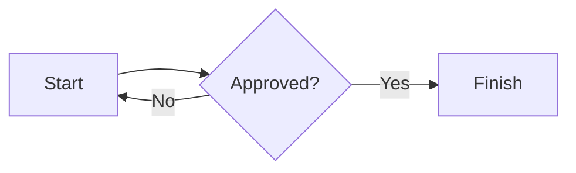

# FoliMarkdown

A Markdown document editor with paginated previews, document storage, and exports. Open `index.html` in a browser; no build step or server is required. All local CSS and JavaScript files must remain alongside `index.html` in their folders.

## Features

- Live GitHub Flavored Markdown preview: nested lists, tables, task lists, code, links, and images.
- A4/Letter paper, portrait/landscape, margins, headers, footers, page numbers, page breaks, and document fonts.
- Mermaid charts and diagrams from fenced `mermaid`, `chart`, or `diagram` blocks. Mermaid is loaded on demand from a CDN and needs an internet connection; the rest of the editor works offline.
- Find and replace (one or all), result highlighting, outline navigation, undo/redo, and keyboard shortcuts.
- Multiple documents in IndexedDB: create, rename, duplicate, move to Trash, restore, or permanently delete. Autosave and draft recovery are enabled. If IndexedDB is unavailable, the app falls back to `localStorage` with limited capacity.
- Insert PNG, JPEG, GIF, WebP, and AVIF images by selecting a file, pasting, or dragging and dropping (up to 8 MB each, 16 MB per batch). The editor uses short `asset:` references and stores image data separately in the browser. SVG uploads are not supported.
- Export Markdown (`.md`), standalone HTML, editable DOCX, and PDF; or use the browser's Print / Save as PDF dialog.

## Export details

- **Markdown:** exported `.md` files include page layout metadata in an HTML comment and embed locally stored images as data URLs. Older `mdword:layout` comments remain importable. Copying the editor's raw `asset:` references alone does *not* include images; use Download Markdown to move a document elsewhere.
- **HTML:** includes the application CSS and rendered pages. Google Fonts still require internet access when opened; rendered Mermaid SVGs are embedded.
- **DOCX:** headings, lists, tables, links, most inline formatting, headers/footers, and images remain editable or embedded. GIF/WebP/AVIF images and Mermaid visuals are converted to PNG. External images require successful CORS access. Pagination may differ from the browser preview, and a selected Google Font may need to be installed on the receiving computer.
- **PDF:** Export PDF downloads a rasterized PDF of the preview, preserving page appearance, images, and headers/footers. The text is *not* selectable or searchable. For a PDF with selectable text, use Print / PDF and choose Save as PDF instead. Large documents may take longer. External images must allow CORS to appear in the direct export.

Insert a manual page break on its own line with `<!-- pagebreak -->`.

Example diagram:

````markdown

````

## Keyboard shortcuts

| Shortcut | Action |
| --- | --- |
| `Ctrl/⌘ + B` / `Ctrl/⌘ + I` | Bold / italic in the editor |
| `Ctrl/⌘ + K` | Insert link |
| `Ctrl/⌘ + Enter` | Insert page break |
| `Ctrl/⌘ + Z` / `Ctrl/⌘ + Shift + Z` | Undo / redo |
| `Ctrl/⌘ + S` | Download Markdown |
| `Ctrl/⌘ + O` | Open a Markdown file |
| `Ctrl/⌘ + F` | Find in document |
| `Ctrl/⌘ + P` | Print / Save as PDF |

## Project structure

```text
index.html                 HTML layout and script loading order
styles/app.css             Application and print styles
src/state.js               Shared configuration and application state
src/markdown.js            Markdown parser configuration and preview rendering
src/diagrams.js            Mermaid loading, rendering, and retries
src/layout.js              Paper settings, pagination, and visual readiness
src/search.js              Search, highlights, outline, and replace
src/storage.js             IndexedDB, records, autosave, and draft handling
src/assets.js              Image storage, insertion, and portable Markdown conversion
src/editor.js              Editing commands, selection, and undo history
src/view.js                View switching, navigation, and notifications
src/export-styles.js       Generated CSS fallback for standalone file:// exports
src/files.js               Markdown import/export and standalone HTML export
src/library.js             Document library, Trash, and startup recovery
src/pdf.js                 Direct PDF export
src/docx.js                DOCX generation and ZIP packaging
src/actions.js             Toolbar action dispatch
src/events.js              DOM, keyboard, paste, and drag/drop listeners
src/boot.js                Starts the library after all feature scripts load
vendor/                    Third-party libraries, bundled for offline use
```

The app deliberately uses **ordered classic scripts**, not ES modules: browsers may block module imports from `file://`. Each `src/` file uses the same global lexical scope and depends on the preceding scripts. Add new files before `src/events.js` and `src/boot.js` in `index.html` as appropriate; avoid redeclaring top-level `const` or `let` names. Keep third-party code in `vendor/` and do not edit it for app features. No package install, network access, or build tool is needed to run the application.

After editing `styles/app.css`, run `node scripts/sync-export-css.cjs` and commit the generated `src/export-styles.js`. This fallback embeds the same CSS in downloaded HTML when browsers block stylesheet access on `file://`. Check that it is current with `node scripts/sync-export-css.cjs --check`.

For browser smoke tests, install Puppeteer in your development environment and run `node tests/smoke.cjs`. The tests use a temporary browser profile and local HTTP server, exercise both `file://` and HTTP, and check editing, persistence, portable images, standalone HTML screen/print styles, Markdown import, all four download formats, library operations, and mobile preview. Test documents and downloads are removed afterward.

## Storage and privacy

Documents and image assets stay in the current browser profile for this page's origin. They are not synchronized between devices; clearing site storage or using private browsing can erase them. Download `.md` backups regularly. If storage is full, older inline Base64 images are kept rather than discarded, and the app prompts you to back up your work.

## Third-party notices

`vendor/marked.min.js` uses **Marked 17 (MIT)**, `vendor/html2canvas.min.js` uses **html2canvas 1.4.1 (MIT)**, and `vendor/jspdf.umd.min.js` uses **jsPDF 3.0.3 (MIT)**. Copyright and license notices are retained in the distributed files. Mermaid is loaded from a CDN when needed, and Google Fonts are requested when selected. Keep the license notices when redistributing the app; the project is not affiliated with any other office software.
